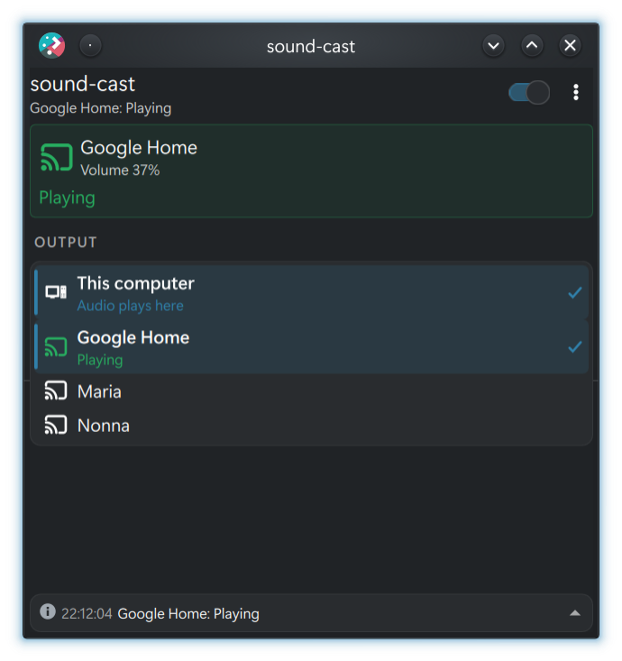

# sound-cast

Plays the audio of a Linux desktop on Chromecast speakers and speaker groups.

sound-cast finds the Cast devices on the network and creates one PipeWire sink
for each ("Sala", "Cucina", a speaker group). Route an application to a sink and
its audio plays in that room. Nothing is cast while nothing plays.



*The [Plasma widget](https://github.com/iupsilon/plasma-applet-sound-cast) is
optional: any PipeWire mixer (pavucontrol, the Plasma volume applet, GNOME
Settings) can route audio to the sinks.*

## Features

- One PipeWire sink per Chromecast, Google/Nest speaker, speaker group or TV.
- Starts casting when audio arrives on a sink and stops 20 s after it ends.
- Sink volume and mute follow the device, both ways.
- Yields to another app (YouTube, Spotify) that takes the device, and can take it back.
- Shows the room name and a logo on devices with a screen.
- A D-Bus interface for status and control, used by the Plasma widget.
- No configuration file, nothing written to disk.

## Requirements

- Linux with PipeWire (with `pipewire-pulse` or not) and systemd user services.
- Chromecast devices on the same LAN, reachable through mDNS.
- The Cast devices fetch the audio over HTTP from the computer, on port 3000 by
  default. A firewall must allow it from the LAN, for example:

  ```sh
  sudo ufw allow 3000/tcp
  sudo firewall-cmd --permanent --add-port=3000/tcp && sudo firewall-cmd --reload
  ```

## Install

Download the package for your distribution from the
[latest release](https://github.com/iupsilon/sound-cast/releases/latest).

| Distribution | Package | Install |
|---|---|---|
| Arch Linux, CachyOS, Manjaro | `sound-cast-X.Y.Z-1-x86_64.pkg.tar.zst` | `sudo pacman -U ./sound-cast-*.pkg.tar.zst` |
| Debian 12+, Ubuntu 24.04+ | `sound-cast_X.Y.Z-1_amd64.deb` | `sudo apt install ./sound-cast_*.deb` |
| Fedora | `sound-cast-X.Y.Z-1.x86_64.rpm` | `sudo dnf install ./sound-cast-*.rpm` |
| Other (x86-64) | `sound-cast-X.Y.Z-x86_64-linux` | see [Without a package](#without-a-package) |

The binary is built on Debian 12, so it runs on that and newer distributions.
It is tested on Arch Linux and CachyOS; the `.deb` and `.rpm` packages are built
the same way but are less tested. Reports are welcome.

On Arch you can also build the package from source with the `PKGBUILD` in
[`packaging/arch`](packaging/arch):

```sh
cd packaging/arch && makepkg -si
```

Then start the service for your user, and enable it at login:

```sh
systemctl --user enable --now sound-cast
journalctl --user -u sound-cast -f     # the log
```

The Chromecasts appear as new outputs within a few seconds.

### Without a package

```sh
install -Dm755 sound-cast-*-x86_64-linux ~/.local/bin/sound-cast
sed 's|^ExecStart=.*|ExecStart=%h/.local/bin/sound-cast|' sound-cast.service \
  > ~/.config/systemd/user/sound-cast.service
systemctl --user daemon-reload
systemctl --user enable --now sound-cast
```

## Usage

Pick a room as the output in any audio mixer, or move a single application's
stream to it. The sinks are named `sound-cast.<room>`, for example
`sound-cast.sala`:

```sh
pactl list short sinks | grep sound-cast
pactl set-default-sink sound-cast.sala
```

Command line options, for running it by hand:

```sh
sound-cast                  # every device on the network
sound-cast --only Sala      # only this device or group
```

- `--port PORT`: TCP port of the audio streams (default 3000).
- `--only NAME`: create a sink only for this device or group. Repeatable.
- `--no-cast`: create the sinks and serve the streams, but never play on a
  device. For tests.
- `--version`: print the version and exit.

To change the options of the service, override its command line:

```sh
systemctl --user edit sound-cast
# [Service]
# ExecStart=
# ExecStart=/usr/bin/sound-cast --port 3001
```

## How it works

- **Sinks**: native PipeWire nodes owned by the daemon. They disappear when it
  stops.
- **Stream**: each sink is served as an endless WAV stream (48 kHz, stereo,
  16 bit) at `http://<host>:<port>/stream/<token>/<room>`. The token is a
  random secret drawn at startup, so other hosts on the LAN cannot guess the
  URL. Nothing is written to disk.
- **Cast**: when a sink receives audio, the daemon starts the default media
  receiver on the device and loads the stream. After 20 s without audio it stops
  the receiver. If another sender takes the device, the daemon yields until its
  own audio stops and starts again. A device with a screen (a TV) shows the
  room name over the sound-cast logo, served at `http://<host>:<port>/logo.png`.
- **Volume**: the sink volume and mute are the device's volume and mute. A
  change on either side moves the other. The audio itself is always sent at
  full level. When a session starts, the device's level wins, so a sink left at
  100% does not make a quiet speaker loud. Mute follows the sink: a muted sink
  never starts a session, so a device left muted is unmuted.
- **Discovery**: mDNS, continuous. A device that leaves the network for a minute
  loses its sink.

## D-Bus interface

On the session bus: service `org.soundcast.Daemon`, object `/org/soundcast/Daemon`,
interface `org.soundcast.Daemon1`. The
[Plasma widget](https://github.com/iupsilon/plasma-applet-sound-cast) uses it.

- `Status` (property, JSON string): `{"now", "port", "devices": [...]}`. Each device has
  `key`, `friendly_name`, `sink_name`, `phase`, `reason`, `since`, `deadline`,
  `lost_until`, `listeners` (open stream connections), `buffering_last_minute`,
  `volume` (0-100 or null) and `muted`. Times are Unix seconds.
- Phases: `ready`, `connecting`, `launching`, `loading`, `playing`, `buffering`,
  `paused`, `lingering` (no audio, stops at `deadline`), `restarting` (after an
  error, retries at `deadline`), `busy` (another app took the device; `reason` is
  its name).
- `Events` (property, JSON string): the last 50 events, each
  `{"ts", "level", "code", "sink_name", "args"}`.
- `Resume(s sink_name)` (method): take a device back from the app that took it.
- `Stop(s sink_name)` (method): end now a session that has no audio and is waiting
  out its 20 s grace period.

Both properties send `PropertiesChanged`, at most every 100 ms: nothing needs polling.

```sh
busctl --user get-property org.soundcast.Daemon /org/soundcast/Daemon \
  org.soundcast.Daemon1 Status
```

## Build from source

Needs Rust (stable, edition 2024), `clang`, `pkg-config` and the PipeWire
development files:

| Distribution | Build dependencies |
|---|---|
| Arch Linux | `sudo pacman -S --needed rust clang pkgconf libpipewire` |
| Debian, Ubuntu | `sudo apt install build-essential clang libclang-dev pkg-config libpipewire-0.3-dev` (Rust from [rustup](https://rustup.rs)) |
| Fedora | `sudo dnf install gcc clang clang-devel pkgconf pipewire-devel cargo` |

```sh
cargo build --release
target/release/sound-cast --only Sala
cargo test
```

To install it for your user as a service:

```sh
cargo install --path .
cp sound-cast.service ~/.config/systemd/user/
systemctl --user daemon-reload
systemctl --user enable --now sound-cast
```

## Build the packages

[`packaging/package.sh`](packaging/package.sh) builds the binary and the `.deb`,
`.rpm` and Arch packages into `dist/`. It needs the build dependencies above and
[nfpm](https://nfpm.goreleaser.com):

```sh
packaging/package.sh
```

The [Packages workflow](.github/workflows/release.yml) runs it on Debian 12 for
every push. For a tag it also publishes a GitHub release with the packages.

## Releasing

1. Set the new version in `Cargo.toml` and run `cargo build` to update `Cargo.lock`.
2. Add a section for it at the top of [`CHANGELOG.md`](CHANGELOG.md).
3. Commit, tag and push:

   ```sh
   git tag -a v0.2.0 -m "sound-cast 0.2.0"
   git push origin master v0.2.0
   ```

The workflow checks that the tag matches `Cargo.toml`, builds the packages and
publishes the release with the notes from the changelog. For Arch, update
`pkgver` in `packaging/arch/PKGBUILD`.

## Limitations

- The audio is sent as uncompressed WAV (about 1.5 Mbit/s per room). Wi-Fi with
  many rooms may struggle. Compressed audio (FLAC) is planned.
- Rooms are not kept in sync with each other: use a Cast speaker group for
  synchronised playback.
- IPv4 only, x86-64 packages only.

## License

GPL-3.0-or-later. See [`LICENSE`](LICENSE).
